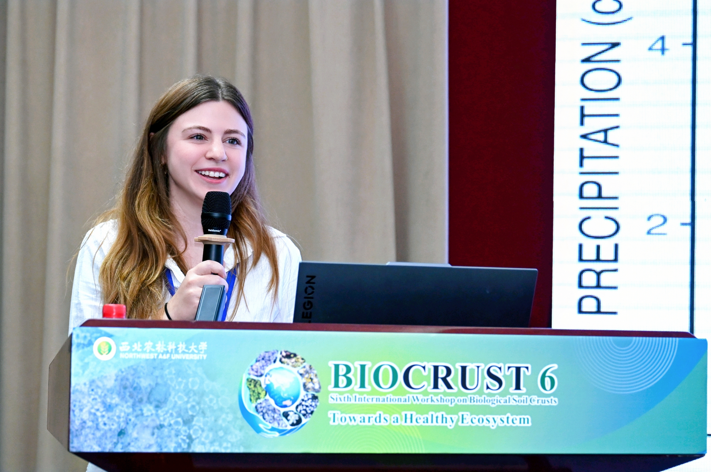
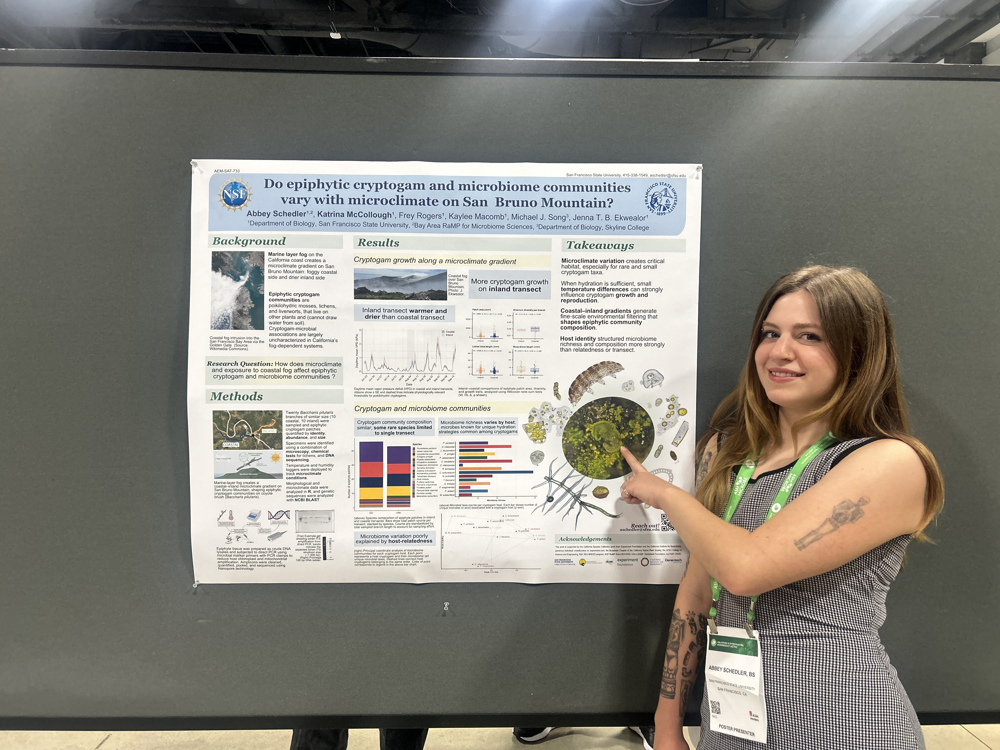
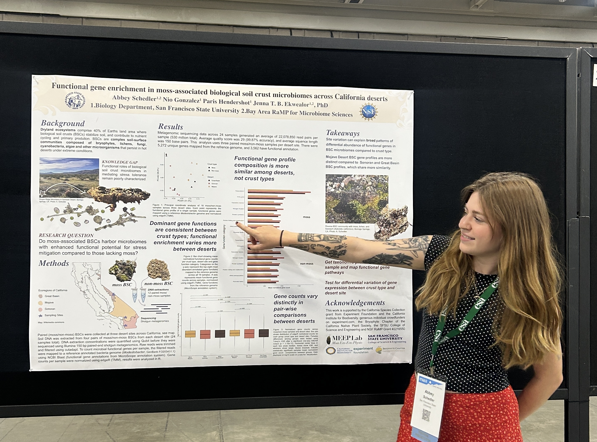

[**Abbey Schedler**](../../content/authors/AbbeySchedler/)’s post-
baccalaureate year in the MEEP Lab has come to an end, and we have a lot to
celebrate!

From research and conference presentations to mentoring and lab leadership,
Abbey made a lasting contribution to our growing lab.
Abbey joined us through the NSF-funded [Bay Area RaMP Program in Microbiome
Sciences](https://sites.google.com/berkeley.edu/rampmicrobiomes/), which
provides paid research opportunities for recent college graduates to develop
their skills and gain experience as independent scientists.
Alongside mentored research, scholars participated in a three-week research
immersion, cohort activities, and ongoing scientific and professional
development workshops.

This combination of research, training, and community meant a busy and
productive year for Abbey!

Much of Abbey’s research centered on our San Bruno Mountain fog project,
investigating mosses, lichens, and their associated microbial communities
across contrasting microclimates.

That work led to her first-author preprint, [“Epiphytic cryptogam communities
differ little despite strong variation in coastal fog
exposure”](https://doi.org/10.64898/2026.10.16.759761).
She also co-authored [“Molecular Data From Herbarium Specimens Reveal A
Potential Extirpation of *Azolla microphylla* From
California”](https://doi.org/10.64898/2026.10.16.758102), a collaboration
with [Dr. Michael J. Song](https://orcid.org/0000-0001-5961-753X).
Both manuscripts will soon be submitted to peer-reviewed journals.

Abbey’s research also took her into California’s deserts, exploring
biological soil crusts and their associated microbes, microfauna, and
arthropods.

<figure>

  
  <figcaption>Abbey collecting moss during fieldwork for the labs' Deserts project.
</figcaption>
</figure>

She successfully secured independent research support through Experiment.com,
the California Institute for Biodiversity, and the California Native Plant
Society’s Bryophyte Chapter.

Her funded project, [“Tiny worlds in desert
moss”](https://experiment.com/projects/tiny-worlds-in-desert-moss-microbes-
and-microfauna-in-biological-soil-crusts), is one example of the new research
directions she helped develop during her time here.
Abbey presented her work to audiences close to home and around the world,
presenting at regional and national American Society for Microbiology
meetings, the Ecological Society of America meeting, Biocrust6 in China, and
the Bay Area RaMP symposium.

These experiences gave her opportunities to exchange ideas and connect with
researchers across microbiology, ecology, and biocrust science.

<figure>

  
  <figcaption>Abbey during her oral presentation at the BIOCRUST6 conference in China.
  </figcaption>
</figure>

<figure>

  
  <figcaption>Abbey presenting her poster at the American Society for Microbiology conference.
</figcaption>
</figure>

<figure>

  
  <figcaption>Abbey presenting her poster at the Ecological Society of America conference.
</figcaption>
</figure>

Within MEEP, Abbey took on a leadership role as our Lab Overseer, helping
develop protocols, update our website, train others, and organize (and
reorganize!) the lab to make it more efficient and accessible.
She also mentored a high school student through a biocrust experiment that
earned finalist recognition and advanced to a regional competition, and
participated in several community outreach events such as with the non-profit
Community Resources for Science.

These are just a few examples of the care and initiative she brought to the
lab and the wider community.
Thank you, Abbey, for your hard work, curiosity, friendly demeanor, and
organizational magic.

It was a joy to have you in the MEEP Lab.

We’re grateful to NSF RaMP for supporting her time with us, proud of
everything she accomplished, and looking forward to future MEEP reunion
labtivities!
