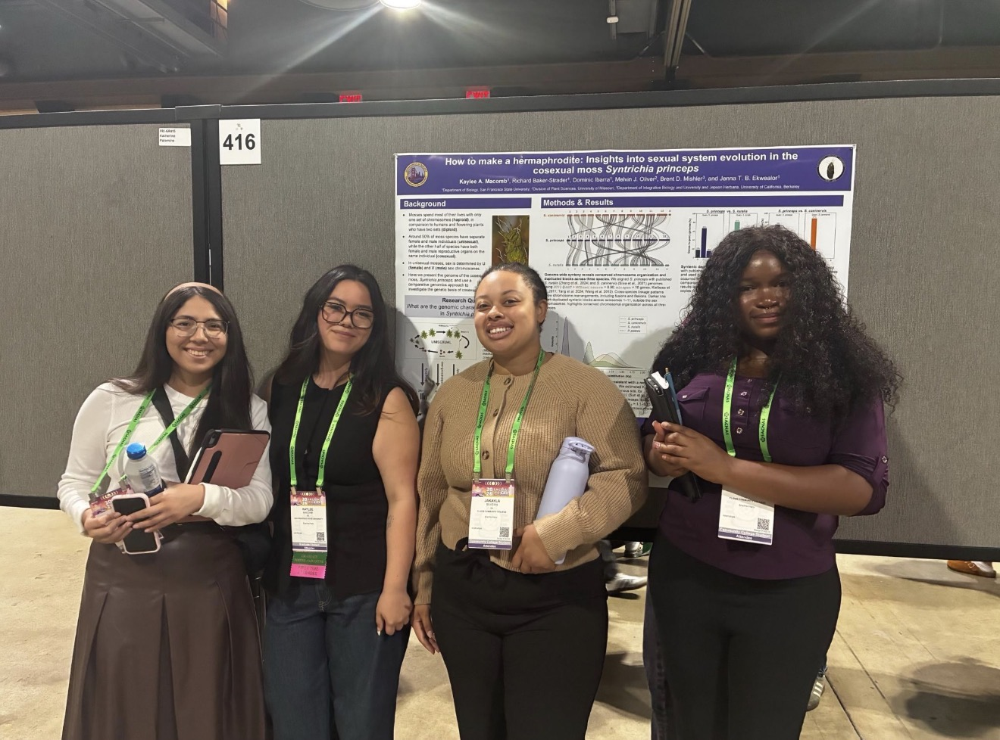

First-year MEEP graduate researcher [**Kaylee Macomb**](../../../author/kaylee-macomb/) presented her research at the [Society for the Advancement of Chicanos and Native Americans in Science (SACNAS)](https://www.sacnas.org/) National Diversity in STEM Conference in Long Beach, CA!

Kaylee presented a poster during the Thursday session titled *"How to make a hermaphrodite: Insights into sexual system evolution in the genome of a cosexual moss *Syntrichia princeps*."* 
Her research looks at the genetic basis of cosexuality in *S. princeps*. Using both computational and molecular approaches, she is studying how cosexuality (monoicy) is represented within the *S. princeps* genome and which biological mechanisms could have led to its evolution.

<figure>
  
  <figcaption>Kaylee with her poster at SACNAS.</figcaption>
</figure>

<figure>
  
  <figcaption>Kaylee with students from Clovis Community College who stopped by to listen to her research!</figcaption>
</figure>

Kaylee attended SACNAS with support from a SACNAS travel scholarship, funded through the Maxwell/Hanrahan Foundation. 

<figure>
  
  <figcaption>The SACNAS opening ceremony.</figcaption>
</figure>

Congratulations, Kaylee!
