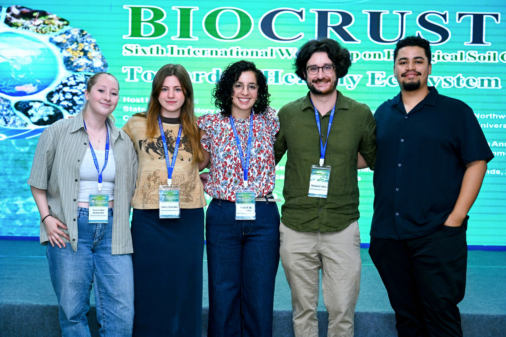
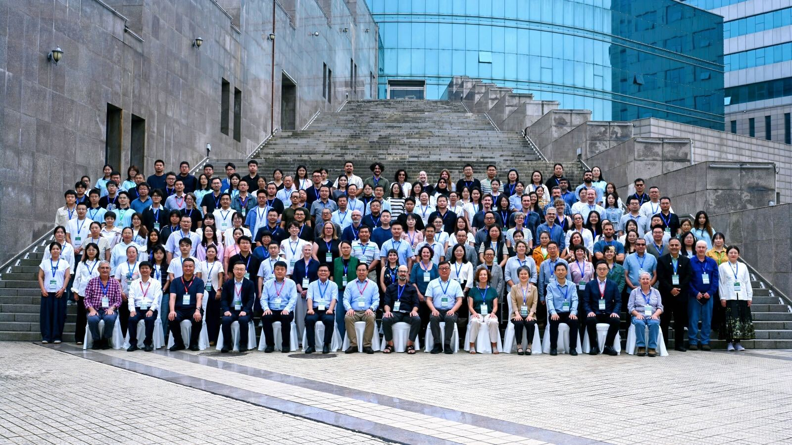
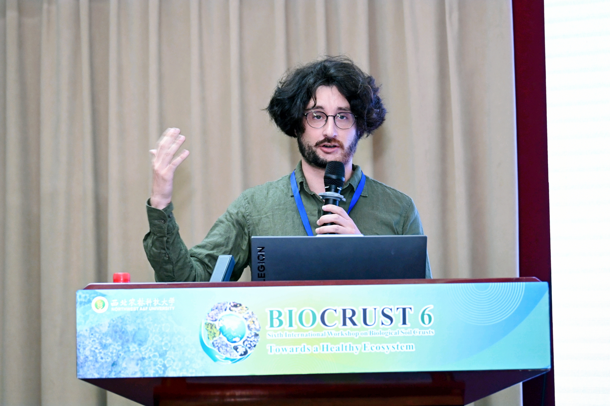
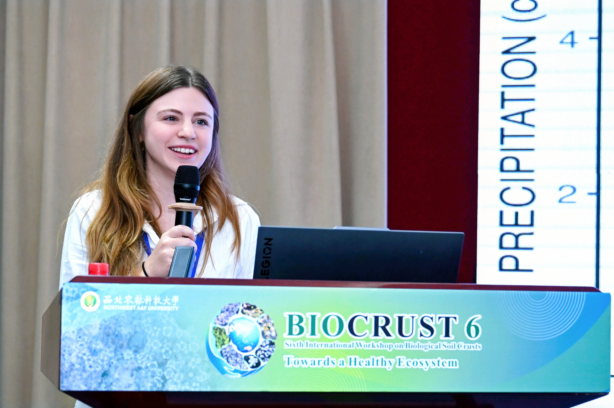
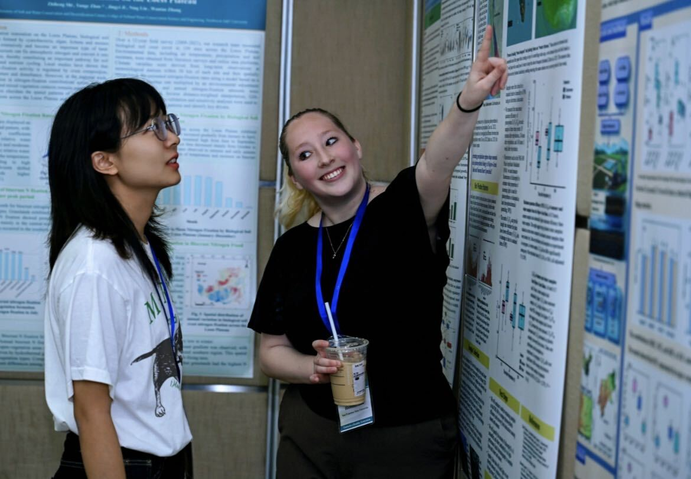
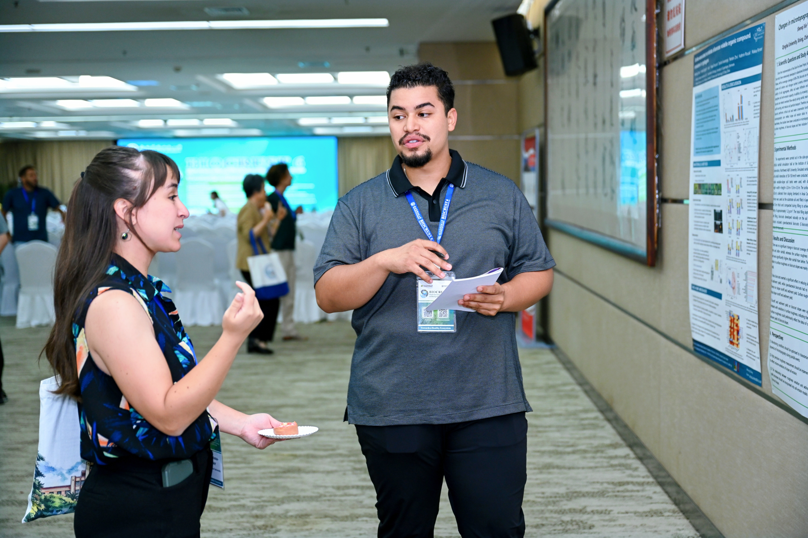
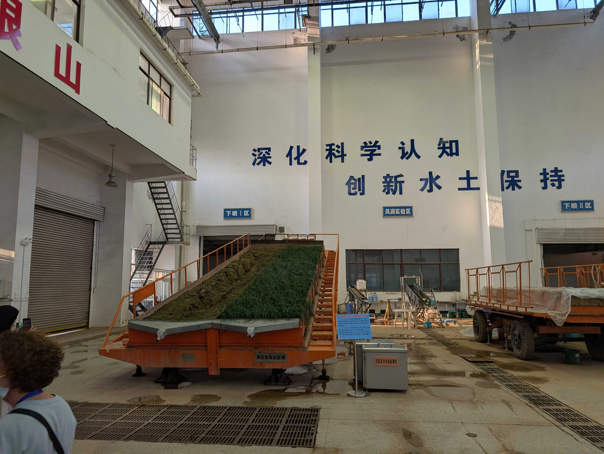

Five members of the MEEP Lab headed to Yangling, Shaanxi, China, for the [Sixth International Workshop on Biological Soil Crusts (Biocrust6)](https://biocrust6.meeting666.com/), held September 14–20, 2026!
PI [**Jenna Ekwealor**](../../../author/jenna-t.-b.-ekwealor/), graduate students [**Paris Hendershot**](../../../author/paris-hendershot/), [**Michael Collins**](../../../author/michael-collins/), and [**Joshua Harris**](../../../author/joshua-harris/), and NSF RaMP post-baccalaureate researcher [**Abbey Schedler**](../../../author/abbey-schedler/) spent the week sharing their work, meeting researchers from around the world, and getting to know the region.

<figure>
  
  <figcaption>MEEP Lab members posing for a group photo at the conference.</figcaption>
</figure>

Hosted by [Northwest A&F University](https://en.nwafu.edu.cn/), the meeting brought together nearly 200 participants from 15 countries and 65 institutions.
The schedule was packed: 88 talks and 40 posters across 12 themes, covering everything from biocrust diversity and physiology to restoration and climate change.
With four days of talks and posters followed by excursions, the group had a full week of biocrustivities!

<figure>
  
  <figcaption>Conference attendes pose for a group photo (Can you spot our MEEP members?).</figcaption>
</figure>

Biocrusts are communities of mosses, lichens, cyanobacteria, algae, fungi, and other microorganisms living at the soil surface.
They help hold soils in place, cycle nutrients, and take up carbon, while also shaping how water moves through ecosystems.
People at the meeting were studying everything from individual genes to whole landscapes.
It was a great chance to see how our work on mosses and their microbial neighbors fits into the bigger picture.

Abbey and Michael gave talks, and Paris and Joshua presented posters.
Jenna gave two talks and served as session chair on day 1.
From alpine snowbanks to California deserts, the MEEP presentations covered a lot of ground and, in true MEEP fashion, a lot of *Syntrichia*!

<figure>
  
  <figcaption>Caption goes here.</figcaption>
</figure>

Michael presented *“Surviving under snow: a physiological and microenvironmental analysis of the alpine moss Syntrichia norvegica.”*
Michael is looking at how this high-elevation moss handles cold and long periods under snow, using measurements of photosynthesis and analyses of genes involved in cold responses.
One big question is whether the moss stays active beneath winter snowbanks or waits things out in a dormant state until spring.
Plans to monitor conditions around moss patches in the Sierra Nevada will help connect the lab experiments with life under an actual snowbank.

<figure>
  
  <figcaption>Michael presenting his talk.</figcaption>
</figure>

Abbey’s talk, *“Functional gene enrichment in moss-associated biological soil crust microbiomes across California deserts,”* explored the microbial communities living alongside desert mosses.
She’s comparing crusts with and without moss from California’s Great Basin, Mojave, and Colorado deserts, using DNA sequencing to find out which microbes are there and what they might be able to do.
In particular, she’s asking whether the microbial communities around mosses carry more genes involved in UV protection, DNA repair, and coping with dry conditions.
It’s a way to look beyond the mosses and lichens we can see and learn about the microbes sharing their space.

<figure>
  
  <figcaption>Abbey during her talk.</figcaption>
</figure>

Paris presented *“Surviving the seasons: Photosynthetic physiology of desert biocrust mosses across two desert ecosystems.”*
Paris is looking at what changing seasons mean for desert mosses, especially in places with different seasonal rainfall patterns.
With samples collected across three seasons, Paris is measuring photosynthetic performance and the pigments mosses use to capture light and protect themselves.
The goal is to understand how the timing of rain shapes moss activity throughout the year, and what changing rainfall patterns might mean for these communities.

<figure>
  
  <figcaption>Paris engaging in conversation with another scientist during her poster session.</figcaption>
</figure>

Joshua’s poster, *“Linking biocrust integrity to soil fungal communities and Valley Fever exposure risk in California’s Central Valley,”* brought environmental health into the conversation.
Joshua is studying what happens to soil fungal communities when biocrusts are disturbed, including how those changes might relate to *Coccidioides*, the fungi that cause Valley Fever.
The project brings together spatial analyses, studies of soil fungi, and a closer look at local microhabitats to explore possible links among biocrust condition, dust, and exposure risk.

<figure>
  
  <figcaption>Joshua presenting his poster to a fellow attendee.</figcaption>
</figure>

Jenna’s first talk, *“Mid-Miocene climate change is associated with the evolution of stress tolerance and higher diversification in the biocrust moss Syntrichia,”* took a look back at how past climate change may have shaped moss evolution.
The study pairs a moss family tree with tests of freezing and drying tolerance to explore connections among expanding cold and dry habitats, stress tolerance, and the evolution of moss diversity.
Her second talk, *“Different defenses under the same sun: Responses to ultraviolet radiation in two dryland mosses,”* compared how two *Syntrichia* species handle UV exposure when hydrated and dry.
This work is now available as a preprint: [*Water status shapes responses to ultraviolet radiation in two stress-tolerant mosses*](https://doi.org/10.1101/2022.09.14.508022).
Both projects explore how mosses evolved to survive in exposed habitats and how they manage it today.

<figure>
  
  <figcaption>Caption goes here.</figcaption>
</figure>

There was plenty to learn beyond our own presentations, too.
CrustNet training sessions brought together more than 100 participants to share sampling and experimental methods so that studies from around the world can be compared.
Restoration sessions covered approaches such as growing biocrust carpets, transplanting crusts, and using microbial inocula.
The conference also featured a “Biocrust and Art” program and an initiative to get an International Biocrust Society started.

<figure>
  
  <figcaption>Caption goes here.</figcaption>
</figure>

The [conference excursions](https://biocrust6.meeting666.com/field-trip-routes) gave the crew a chance to explore Qinling Science Park and Louguantai Forest Park in the Qinling Mountains.
Temperate and subtropical zones meet in this mountain range, making it a particularly interesting place to look at biodiversity and conservation.
Pandas and monkeys were highlights of the excursion, and the crew took plenty of photos of the plants and animals they encountered.

<figure>
  
  <figcaption>A Chinese black bear donning some Mickey Mouse-esque ears!</figcaption>
</figure>

<figure>
  
  <figcaption>The Qinlin Mountains.</figcaption>
</figure>

Back in Yangling, the group joined a guided tour of Northwest A&F University’s Expo Park, visiting museums devoted to zoology, entomology, and Chinese agriculture.
Paris especially liked an artwork made from the wings of butterfly specimens.

<figure>
  
  <figcaption>Michael viewing an entomology artpiece.</figcaption>
</figure>

Some lab members also stopped by the university’s rainfall simulation facilities.
Students showed them biocrusts they had grown themselves, along with samples collected from the field.
The group got to ask questions, compare approaches, and see some of the experiments behind the university’s soil and water conservation research.

<figure>
  
  <figcaption>Rainfall simulator.</figcaption>
</figure>

There was plenty of good food between talks and field trips, too.
Fresh vegetables and spicy, warming meals were highlights, and invitations to dinner with locals made the week feel especially welcoming.
Getting to know people over food was part of the fun of spending a week together in Yangling.

<figure>
  
  <figcaption>Caption goes here.</figcaption>
</figure>

Congratulations to Abbey, Michael, Paris, and Joshua on sharing their research at Biocrust6!
And thank you to the organizers and our hosts at Northwest A&F University for a week of science, exploration, and hospitality.


